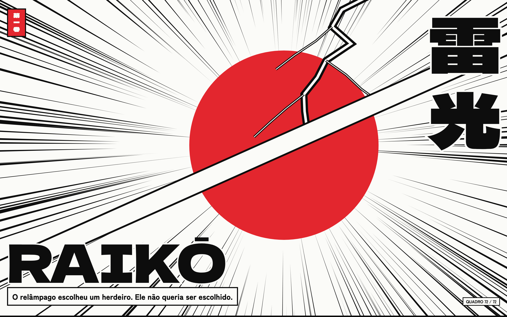
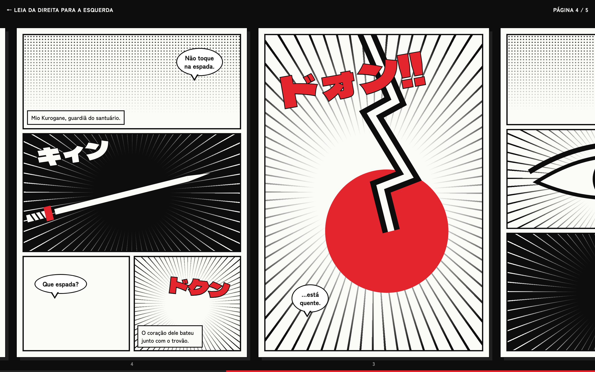
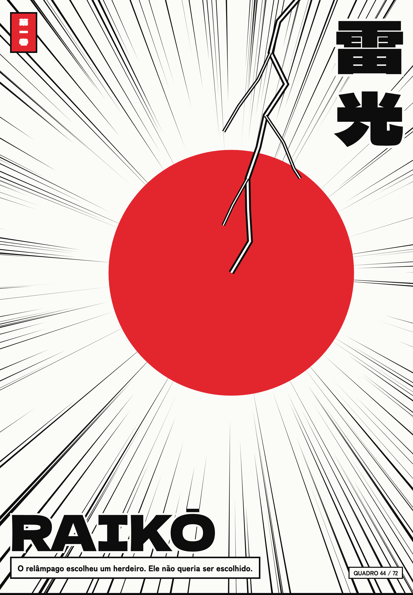
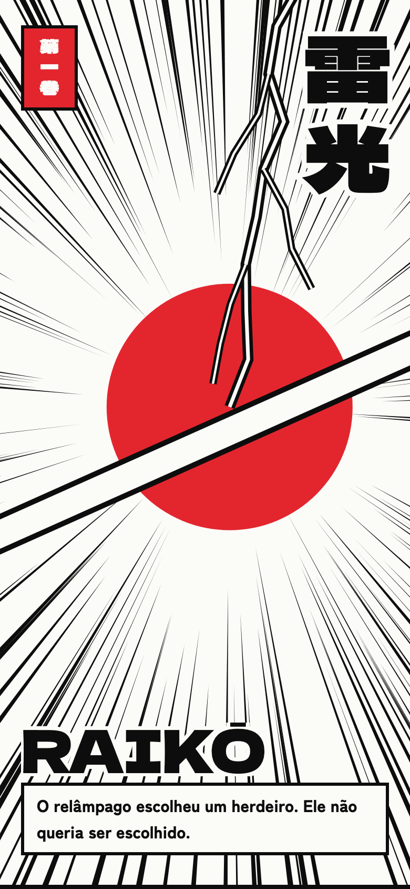
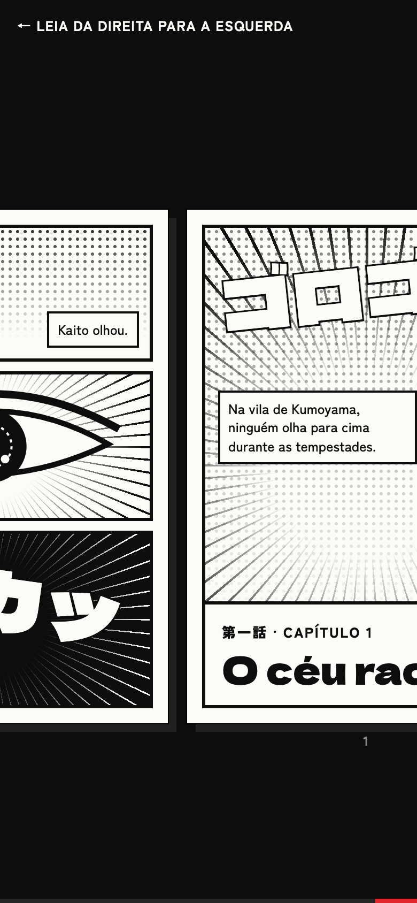
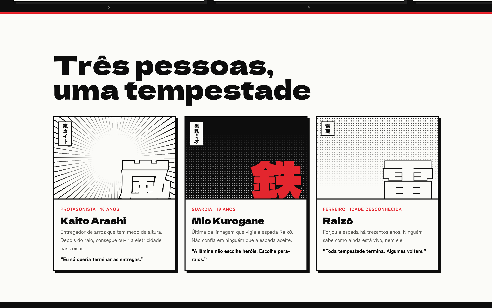

# Raikō 雷光

Página de lançamento de um anime fictício, apresentada como mangá. Na capa, uma sequência de 72 quadros desenhados em canvas avança com o scroll: o raio cai, o sol cresce e a lâmina corta a tela. Depois, o capítulo 1 é lido como mangá de verdade, da direita para a esquerda, com o scroll vertical movendo as páginas.





<p align="center">
  
  &nbsp;
  
  &nbsp;
  
</p>



## O que tem na página

- **Capa em 72 quadros**: linhas de velocidade, sol vermelho, o raio com galhos e o corte da lâmina, desenhados em canvas e escolhidos pelo progresso do scroll, com contador de quadro
- **Capítulo 1 em cinco páginas de mangá**, lidas da direita para a esquerda: o scroll vertical move a faixa, com página atual e barra de leitura
- **Onomatopeias que estouram** ao entrar na tela, balões com rabicho, narração, retícula e linhas de velocidade
- **Elenco** em cartões com o nome em japonês na vertical e o kanji de cada personagem subindo
- **Estreia** com a ficha da série e atalho para reler o capítulo
- Scroll suave, inclusive nos links internos, e respeito à preferência do sistema por menos movimento (a capa já mostra o último quadro)

## Tecnologias

| Tecnologia                                                                   | Uso                                                   |
| ---------------------------------------------------------------------------- | ----------------------------------------------------- |
| [Next.js 16](https://nextjs.org) (App Router)                                | framework, renderização estática e fontes             |
| [React 19](https://react.dev) + [TypeScript](https://www.typescriptlang.org) | interface e tipagem                                   |
| [Motion](https://motion.dev)                                                 | scroll da capa e do capítulo, onomatopeias e entradas |
| [Lenis](https://lenis.darkroom.engineering)                                  | scroll suave                                          |
| Canvas 2D                                                                    | sequência de quadros da capa                          |
| [Tailwind CSS 4](https://tailwindcss.com)                                    | estilos e layout responsivo                           |
| [Playwright](https://playwright.dev)                                         | geração dos prints deste README                       |
| ESLint + Prettier                                                            | padrão de código e formatação                         |

## Como rodar

Precisa de [Node.js](https://nodejs.org) 22 ou mais recente.

```bash
npm install
npm run dev
```

Abra http://localhost:3000. Para testar no celular na mesma rede Wi-Fi, rode `npm run dev -- -H 0.0.0.0` e acesse `http://<ip-do-seu-computador>:3000`.

### Comandos

| Comando               | O que faz                                                                                       |
| --------------------- | ----------------------------------------------------------------------------------------------- |
| `npm run dev`         | servidor de desenvolvimento                                                                     |
| `npm run build`       | verifica os tipos e gera a versão de produção                                                   |
| `npm run start`       | serve a versão de produção (depois do build)                                                    |
| `npm run lint`        | ESLint                                                                                          |
| `npm run format`      | Prettier em todo o projeto                                                                      |
| `npm run check`       | testa o domínio: semente determinística, cena do raio e linha do tempo dos quadros              |
| `npm run screenshots` | gera os prints em `docs/` (depois do build; na primeira vez, `npx playwright install chromium`) |

## Estrutura

```
src/
├── app/                   layout, página e estilos globais (Next.js)
├── domain/
│   ├── frames.ts          sequência da capa: semente, cena do raio e linha do tempo
│   └── story.ts           elenco, frase de capa e ficha da estreia
├── lib/drawFrame.ts       desenha um quadro da capa no canvas
├── providers/             scroll suave e configuração do Motion
├── components/
│   ├── molecules/manga/   Page, Panel, Bubble, Narration, Sfx, SpeedLines, Tone
│   └── organisms/         Cover, Chapter (páginas 1 a 5), Cast, Release, Footer
├── lib/                   utilitário cn
└── constants/             curvas de animação
```

Imports usam aliases: `@molecules/*`, `@organisms/*`, `@domain/*`, `@providers/*`, `@lib/*`, `@constants/*`.

---

Obra fictícia, criada como peça de portfólio. Personagens e estúdio não existem.
